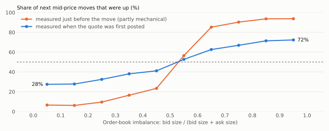

# Peregrine: NASDAQ ITCH 5.0 feed handler in C++20

Decodes real NASDAQ TotalView-ITCH 5.0 market data, rebuilds the full-depth order
book for every listed symbol, and publishes top-of-book changes to a consumer
thread over a lock-free SPSC queue. Input is a recorded file or a live MoldUDP64
stream with gap recovery. Header-only core, no dependencies.


**Demo page:** `docs/index.html` is a self-contained page with an order-book replay and
charts of the full session. Open it in a browser, or serve it with GitHub Pages from `/docs`.
Rebuild it with `python3 scripts/build_page.py` after re-exporting `docs/data/day.json`.

## Results

### Full trading day

The complete 30 Dec 2019 file (3.5 GB compressed, 8.25 GB raw, 268,744,780
messages, 04:00 to 20:00), streamed with `gunzip -c | itchfh -`:

- 0 messages referencing an unknown order across 263.2M book-changing messages.
- 124,767,189 BBO changes published and consumed; consumer state matched the books.
- 0 live orders left at the close: every order added during the day was removed.
- 4.9M msg/s (p50 120 ns, p99 852 ns) while sharing two vCPUs with `gunzip`.
- No duplicate order references, no reduction without a matching price level, and no
  malformed messages.
- 905 crossed BBOs over the day, in 15 stocks, all accounted for: 433 while the stock
  was paused, 53 while halted, 2 in a quotation-only period, and 417 within 1 ms of the
  stock reopening, when the reopening auction is about to execute.

### Benchmarks

First 2 GB of the session (64.5M messages), three runs per build with `scripts/bench.sh`:
Ryzen 7 PRO 7840U under WSL2 (kernel 6.6), 16 threads online, feed thread pinned to
core 2 and the consumer to core 4.

| Build | Throughput | Avg | p50 | p99 | p99.9 |
|---|---|---|---|---|---|
| Baseline: `std::unordered_map` + `std::map` | 1.4-1.5M msg/s | 689-725 ns | 584-617 ns | 2.4-2.6 us | 12.1-16.1 us |
| Peregrine | 6.6-6.9M msg/s | 145-152 ns | 109-111 ns | 657-688 ns | 1.9-2.2 us |

WSL2 is itself a lightweight VM, so these are not tuned bare-metal numbers. This table
was measured before the two changes below and timed with `steady_clock`; re-run
`scripts/bench.sh` for current numbers.

**Timing.** Latency samples now use the processor's time-stamp counter (`rdtsc`, fenced
with `lfence`/`rdtscp`), converted to nanoseconds with a rate calibrated against
`steady_clock` at startup. The counter is invariant on this CPU, so the feed and consumer
threads' readings are comparable. Two limits, printed with every run: AMD Zen advances
the counter in steps of 33 ticks, so samples have **10 ns resolution**, and an empty
timed region reads 20-30 ns, which is included in every sample.

**Huge pages.** The order map (128 MB) is now backed by transparent huge pages, written
once at startup so Linux can back it with 2 MB pages and no page faults land in the run.
In 8 paired runs in the 2-vCPU VM it won 7, with median throughput 6.55M against
6.05M msg/s. `scripts/bench.sh` measures it on your machine as the `itchfh_4k_pages`
row (`PEREGRINE_NO_HUGEPAGES=1`).

### Development history

How the optimized build got there, measured during development in a 2-vCPU Linux VM on
the same laptop, on the same 2 GB slice (04:00 to 10:23:36, 8,906 symbols), threads
pinned. Compare the rows with each other, not with the table above.

| Build | Throughput | Avg | p50 | p99 | p99.9 |
|---|---|---|---|---|---|
| Baseline: `std::unordered_map` + `std::map` | 1.5M msg/s | 654 ns | 561 ns | 2.3 us | 17.7 us |
| v1: flat hash map + sorted level arrays | 4.4-4.5M msg/s | 222-226 ns | 280-291 ns | 1.05 us | 3.1-3.2 us |
| v2: v1 + lookahead prefetch + 16-byte slots | 5.1-5.5M msg/s | 183-197 ns | 120 ns | 0.67-0.73 us | 2.3 us |

Percentiles are per-message (decode + book update + publish), sampled 1 in 64,
timed with `steady_clock`; each sample includes one clock read.

A later change made every execute, cancel, delete and replace do one hash lookup
where it had done up to three. In three back-to-back paired runs on the same slice
it gave 29% to 39% more throughput than version 2 (4.2 to 6.2M against 3.1 to 4.8M
msg/s). The VM was much noisier that day, so the table above is left as measured;
`scripts/bench.sh` re-measures both builds on your own machine.

Correctness on the same data:
- 0 messages referencing an unknown order across 63.0M book-changing messages.
- 28,760,401 BBO changes published and consumed; the consumer's final BBO equals
  the book for all 65,536 locate slots (checked on every run, exit code 1 if not).
- 110 crossed BBOs in this slice. The ones inspected were halted names (MKD, PNRL, SVA), NASDAQ
  test symbols (ZJZZT, ZWZZT) and the 09:30 opening cross.

### Where the time went

`perf` was unavailable in the VM, so each stage was timed in isolation:

| Stage | ns/msg |
|---|---|
| Framing + decode only | 11 |
| + order map | 66-69 |
| + price levels (v1 feed thread) | 211 |
| + two-stage prefetch | 124-127 |
| + 16-byte order slots (v2 feed thread) | 115-124 |

Price levels cost about twice what the order map did. Instrumenting the level
arrays showed the scan itself was short (55% of lookups land at most one level
from the touch, average 13 levels, average shift on insert/erase 20 levels), so
the cost was cache misses hopping between 8,906 symbols, not the algorithm.

The fix: the replay loop runs two cursors ahead of the message being applied.
Sixteen messages early it prefetches the order's hash slot and the symbol's book
header; eight messages early, with the header now cached, it prefetches the
top-of-book end of both level arrays. Distance 8 was the best of 1 to 32.

Huge pages were first tried here and looked useless, but that test was flawed: the map's
first touch of each page was a read, which Linux backs with the shared zero page and
never promotes. See *Huge pages* above for the corrected measurement.

### Slow consumers: backpressure vs conflation

50 MB sample, consumer doing 2 us of simulated work per update:

| Mode | Feed thread wall time | Updates delivered | Queue latency p50 |
|---|---|---|---|
| Backpressure, 65,536-slot queue | 1.31 s | 640,403 of 640,403 | 147 ms |
| `--conflate`, 65,536-slot queue | 0.13 s | 118,921 | 122 ms |
| `--conflate --queue 64` | 0.19 s | 80,788 | 138 us |

Conflation alone keeps the feed thread fast but the consumer still reads stale
data, because nothing is conflated until the deep queue fills. A shallow queue
plus conflation is what bounds staleness. In all three the final consumer state
matched the books.

### MoldUDP64 gap recovery

`tools/moldsend` replays a file as MoldUDP64 and can drop every Nth packet on
purpose. `make udptest` drops 2% over loopback and requires output identical to
a file replay: 732 packets dropped, 732 retransmit requests, 34,295 messages
recovered, identical output. The same test passes over multicast (239.1.1.1),
where the VM also loses packets by itself.

### Signal study: order-book imbalance

`--signal` makes the consumer do something a strategy would. For symbols quoted
one cent wide during regular hours (09:30 to 16:00, full day, 2.87M mid-price
moves), share of moves that were up, by bid size / (bid size + ask size):



| Imbalance | Measured when the quote was first posted | Measured just before the move |
|---|---|---|
| 0.0-0.1 | 27.5% (389,473 moves) | 6.6% |
| 0.1-0.2 | 27.8% | 6.2% |
| 0.2-0.3 | 32.5% | 9.6% |
| 0.3-0.4 | 38.1% | 16.5% |
| 0.4-0.5 | 41.1% | 23.4% |
| 0.5-0.6 | 52.7% | 56.5% |
| 0.6-0.7 | 62.6% | 85.2% |
| 0.7-0.8 | 66.9% | 90.3% |
| 0.8-0.9 | 71.4% | 93.6% |
| 0.9-1.0 | 72.3% (395,535 moves) | 93.7% |

The right-hand column is largely mechanical: a queue about to be exhausted is
small by construction. The left-hand column is the meaningful one. Neither is a
trading result: it is one day, direction only, and ignores the spread, fees
and queue position. Raw output: `docs/signal_run.txt`.

## Example run

The full session, streamed from the compressed file (2-vCPU VM, sharing cores with `gunzip`):

```
$ gunzip -c 12302019.NASDAQ_ITCH50.gz | ./build/itchfh --signal --export AAPL docs/data/day.json - AAPL
messages        268744780 (263241937 book-changing), feed time up to 20:00:00
bbo changes     124767189, 124767189 published, 124767189 consumed, 0 conflated
integrity       0 unknown order refs, 905 crossed BBOs, final consumer state matches books
live orders     0 at end
AAPL     bid 0 @ 0.0000 | ask 0 @ 0.0000 | depth 0 x 0 levels
imbalance = bid size / (bid size + ask size), 1-cent spreads, 09:30-16:00; share of next mid moves that were up
  imbalance   at quote start        just before move
  0.0-0.1      27.5% (  389473)      6.6% (  532062)
  0.1-0.2      27.8% (  294855)      6.2% (  303010)
  0.2-0.3      32.5% (  246731)      9.6% (  220914)
  0.3-0.4      38.1% (  226004)     16.5% (  179645)
  0.4-0.5      41.1% (  115755)     23.4% (   79796)
  0.5-0.6      52.7% (  430742)     56.5% (  326549)
  0.6-0.7      62.6% (  242314)     85.2% (  190101)
  0.7-0.8      66.9% (  186958)     90.3% (  165782)
  0.8-0.9      71.4% (  341674)     93.6% (  342170)
  0.9-1.0      72.3% (  395535)     93.7% (  530132)
wall time       54.534 s
throughput      4.9 M msgs/s (202.9 ns/msg avg)
feed latency    p50 91  p99 812  p99.9 2164  max 3186414 ns (decode + book + publish; includes one clock read)
queue latency   p50 1172  p99 1347450  p99.9 2269596  max 29607715 ns (publish to consume; includes one clock read)
```

The AAPL line is empty because the book is empty at 20:00.

## Queue priority audit

An exchange promises price-time priority: the best price trades first, and at one
price the oldest order trades first. `build/queue_audit` rebuilds every price level as
a queue of individual orders and checks each execution against that, among the
displayed orders ITCH shows. Full session, 30 Dec 2019 (`docs/queue_audit.txt`):

- **Price priority.** Of 5,822,741 executions, 273 (0.005%) were not at the best
  displayed price on their side. All were non-printable `C` executions in stocks that
  were halted, paused, or within one second of a status change.
- **Time priority, ranked by arrival.** Treating the order whose Add message arrived
  first as the oldest leaves 10,565 ordinary (`E`) executions that appear to jump an
  older order; 86% of them fall between 09:30 and 10:00.
- **Time priority, ranked by reference number.** Treating the lowest order reference
  number as the oldest leaves zero: all 5,722,824 `E` executions hit the
  lowest-numbered order at the best displayed price. The difference is 360,450 adds
  (of 140,270,523) that reach the feed after a higher-numbered order at the same price
  level. Most of the apparent jumps come just after the open, which would fit orders
  entered earlier reaching the book at 09:30 out of entry order; that part is a guess.
- **Hidden ranking price.** The 82,365 time exceptions that remain are all `C`
  messages, and 82,345 of them executed at a price more aggressive than the order
  displayed, which fits the order being ranked at a better price than the one shown.
- **Replaces.** A replace gets a new, higher reference number, and the zero-exception
  result holds with it at the back of its queue. Under arrival ranking, letting a
  size-only replace keep its place adds 588 exceptions.

These are what one day of data is consistent with, not rules quoted from NASDAQ.

The same pass measures how often an order trades, by the displayed shares already
ahead of it when it joined or improved the best price in continuous trading:

| Shares ahead | Orders | Traded at least once | Shares traded |
|---|---|---|---|
| 0 (new best price) | 14,833,394 | 9.12% | 4.43% |
| 1-99 | 2,904,290 | 12.87% | 9.66% |
| 100-199 | 7,185,460 | 8.28% | 5.96% |
| 200-499 | 9,958,560 | 6.25% | 4.49% |
| 500-999 | 7,512,517 | 4.24% | 3.25% |
| 1000-1999 | 7,230,477 | 3.35% | 2.56% |
| 2000-4999 | 7,107,201 | 2.67% | 1.89% |
| 5000+ | 8,063,773 | 2.08% | 0.68% |

## Design

- **Zero-copy decode** (`include/itch.hpp`): fields are byte-swapped straight out
  of the buffer into handler calls. No message structs, no allocation. A message
  shorter than its type's layout is skipped and counted, never decoded.
- **Order map** (`include/book.hpp`): open addressing, linear probing,
  backward-shift deletion (no tombstones under constant add/delete churn),
  16-byte slots, pre-sized so it never rehashes mid-session.
- **Price levels**: per-side sorted array with the best price at the back.
- **SPSC queue** (`include/spsc.hpp`): head and tail on separate cache lines, each
  side caching the other's index so the fast path reads no shared line.
- **MoldUDP64** (`include/mold.hpp`): packets ahead of a gap are buffered, the
  missing range is requested (and re-requested after 20 ms), and messages reach
  the book exactly once, in order. Packets from another session are ignored, and
  the receiver gives up with an error if the sender is silent for 5 seconds or a gap
  outgrows its buffer (65,536 packets). Within each packet it prefetches before applying,
  which took the UDP path's median from 161-190 ns to 81-100 ns per message.
- **Pipeline** (`src/pipeline.hpp`): the feed side (books, publishing, conflation) and the
  consumer side (latest BBO, imbalance study), shared by the binary and the tests.
- **Queue audit** (`src/queue_audit.hpp`, `tools/queue_audit.cpp`): per-level order queues
  as intrusive linked lists through a second flat hash map, kept alongside the
  price-level books and checked against them at the end of the run.
- **Export** (`src/export.hpp`): per-minute activity, message mix and depth snapshots as JSON
  for the demo page.
- **Conflation**: a per-symbol dirty flag plus a FIFO of dirty symbols; each
  flushed update carries the newest state.

## Build and run

Linux or WSL, g++ 11+.

```
make test                                    # decoder, differential, order-map and SPSC tests, both builds
make sanitize                                # tests under ASan + UBSan, pipeline under TSan
make udptest                                 # loopback UDP with injected loss vs file replay
make
./build/itchfh data/sample_50MB.itch AAPL    # small real sample
./scripts/get_data.sh                        # full day, 3.5 GB download
./scripts/get_data.sh 2000000000             # or the 2 GB slice used for the benchmarks
./build/itchfh --pin 0,1 --signal data/12302019.itch AAPL SPY MSFT
./build/itchfh_baseline --pin 0,1 data/12302019.itch
./scripts/bench.sh                           # both builds, 3 pinned runs each, as a table
gunzip -c day.gz | ./build/queue_audit - --priority-by-reference   # the priority audit
./build/itchfh --conflate --queue 64 --work 2000 data/sample_50MB.itch
gunzip -c day.gz | ./build/itchfh --signal - AAPL > docs/signal_run.txt   # stream without unpacking to disk
python3 scripts/plot.py docs/signal_run.txt  # regenerate the charts
gunzip -c day.gz | ./build/itchfh --signal --export AAPL docs/data/day.json -   # data for the demo page
python3 scripts/build_page.py                # rebuild docs/index.html
```

## Tests

`tests/test.cpp` encodes a random ITCH stream (adds, executions, cancels,
deletes, replaces in a tight price band), runs it through the decoder and book,
and after every message compares each symbol's BBO against a brute-force
reference that rescans all live orders. It also checks the "BBO changed" flag is
exact and that the SPSC queue delivers 2M items in order across two threads.

The order map is checked against `std::unordered_map` through 200,000 inserts and
erases in a small table, so probe runs collide, wrap and trigger growth. Truncated
and zero-length messages must be skipped and counted. `make sanitize` runs the
tests under AddressSanitizer and UBSan and the two-thread pipeline under
ThreadSanitizer; all three are clean.

Further tests cover the `F` and `C` message layouts, the integrity counters (a reused
order reference, a reduction against the wrong stock), conflation through a 4-slot
queue, the JSON export, and the queue audit on a scripted stream.

## Not done

- Bare-metal numbers: the benchmarks ran under WSL2, the full-day runs in a 2-vCPU VM.
- Snapshot recovery for gaps too large to replay (today the receiver stops with an error).
- The queue audit on more than one day, and against the exchange's published order-type rules.
- Signal study at fixed lead times and across multiple days.

CI (`.github/workflows/ci.yml`) runs the unit tests and the UDP loss test on a
synthetic stream, since NASDAQ's data is not checked in.
